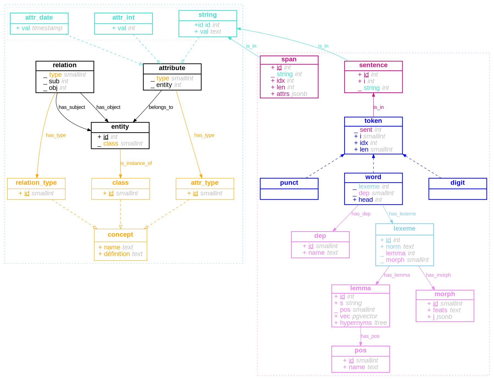

# nlpg

__nlpg__ is *a)* a [PostgreSQL](https://www.postgresql.org/) database schema designed to store the annotations produced by [spaCy](https://spacy.io/) and *b)* a command line interface to interact (e.g. insert or annotate) with the database (see Usage below).

## Schemas

The tables in the [nlpg](#nlpg) schema are designed to receive data produced by spaCy (token, word, lemmatizer, part-of-speech, dependency, morphology, etc.). They are organized to optimize performance and space usage[^DatabaseNormalization].
__nlpg__ provides an optional schema [eav](#eav) that implements a minimal and generic [EAV](https://en.wikipedia.org/wiki/Entity-attribute-value_model) model. This results in a complete and flexible (but rather simple) database.
Together, these two schemas form a hybrid EAV model, but they are independent.

[^DatabaseNormalization]: See the general principles of [database normalization](https://en.wikipedia.org/wiki/Database_normalization).

The diagram below shows the structure of the database. Each rectangle represents a table. The dashed arrows represent [inheritance](https://www.postgresql.org/docs/current/tutorial-inheritance.html) between tables. For example, the word table inherits the columns `sent`, `i`, `idx`, and `len` from the `token` table (see the [spaCy](https://spacy.io/api/token#attributes) documentation for these properties). Conceptually, the inheritance relationship corresponds to the relationship *A is a subclass of B*. The solid arrows represent *foreign keys*. Lines beginning with an underscore also indicate foreign keys: the values of the relevant columns are always `integer` or, for optimization reasons, `smallint`[^SmallInt].

[^SmallInt]: It is highly unlikely that certain tables will exceed a thousand lines. Typically, part-of-speech tags and dependency labels, stored in the tables `pos` and `dep`.

(For a detailed description of the tables, see [below](#tables).)



## Usage

__nlpg__ is also a mini command-line interface that allows you to quickly add data to tables from JSON (or JSONL) files, or annotate texts and insert the annotations into tables (tokens, lemmas, etc.).

To build a complete database with both __nlpg__ and __eav__ schemas:

```bash
psql -c 'create database mydatabase'
nlpg schema both -d mydatabase
```

To add the __nlpg__ schema to an existing database, specify the table that contains the texts so that the foreign keys of the tables in the schema are generated. This table is specified via the `-t` option, whose argument must be in the form of `<schema.table.primary_key>` (the primary key column must be of type integer).

```bash
nlpg schema nlpg -t 'public.text.id' -d myd
```

To import data in the EAV model tables in JSON or JSONL format (respecting a specific structure described below):

```bash
nlpg copy -d 'mydatabase' *.json
nlpg copy --dbname 'mydatabase' --jsonl *.jsonl
```

To annotate texts with spaCy and add the annotation results to tables, use the command `annotate`, which requires two arguments: `model` et `query_file`. The latter must be a filepath (or `-` to read from stdin) containing a SQL query that returns two columns: a text (their content) and an int (the id of the texts).

```bash
nlpg annotate en_core_news_sm query.sql --dbname mydb
nlpg annotate ./path/to/my/model/ - -d mydb  << EOF
SELECT
    val, id
FROM string
EOF
```

The distinction between words and other tokens is made using the attribute `Token._.isword`. By default, all tokens will be considered words. If the used pipeline defines an extension of the form `Token._.isword`, it will be used to make the distinction. The `-w`/`--isword` option also allows you to pass a function, which must be registered in the [spaCy registry misc](https://spacy.io/api/top-level#registry).

## EAV

The __eav__ schema has two levels. The first level concerns the ontology and consists of object classes (e.g., "person"), property types (e.g., "name"), and relationship types (e.g., "knows"). The second level concerns individuals (who constitute the world): objects themselves (e.g., a person), instances of relations (e.g., a relationship between two particular people), and instances of properties (e.g., a person's name).

- The __entity__ table groups things in the world: people, places, physical objects, ideas, or anything else that can be designated and linked to other things. Its columns are reduced to a minimum: an `id` that allows it to be referenced and a `class` that defines its nature.
- The table __relation__ establishes a relationship between two entities (subject and object, __sub__ and __obj__).
- The __attribute__ table allows you to assign properties to entities. A property may optionally have a value, and this value may have different datatypes.

The __string__ table links the two schemas of the database. Like the tables __attr_int__, and __attr_float__, it inherits from the table __attribute__. However, it also has a column called `id` that is referenced by the tables __par__, __sent__, and __span__.

## Import JSON data

It is possible to import structured data in JSON format into the __eav__ schema. Each JSON object describes an entity, its properties, and the relations to which it belongs.

```json
[
    {"id": 1, "class": "library"},
    {"id": 2, "class": "place", "is_magical": null, "height": 1.2, "x": 120, "y": -2},
    {
        "class": "person", "name": "becky", "relations": [
            {"type": "know", "object": 1}
        ]
    },
    {"class": "book", "relations": [{"type": "in", "object": 1}]},
]
```

The only required field is the field `class`. The optional `id` field is useful to define relations between entities (it does not correspond to the `id` of the entity in the database). All fields in entities other than `class`, `id`, or `relations` are interpreted as properties and inserted into tables that correspond to the datatype.

There is one exception: the `xml` attribute table. Properties whose name is prefixed by `xml_` will be added to it, for example `xml_title` or `xml_content`. Functions allow you to remove tags for analysis with spaCy and reinsert them later. (The documentation for these functions is in progress.)

```jsonc
[{"is_magical": null}, // -> eav.attribute (no value)
{"name": "becky"}, // -> eav.string
{"date_birth": 1231}, // -> eav.attr_int
{"y": 1.2}, // -> eav.attr_float
{"arr": [1, 2, 3]}] // -> eav.attr_jsonb
{"xml_content": "<p>this is <i>cool</i>/p>"} // -> eav.xml + eav.string
```

Importation is done using the `copy` command. All positional arguments are treated as files to be imported.

```bash
nlpg copy -d mydatabase data1.json data2.json ../*.json
```
